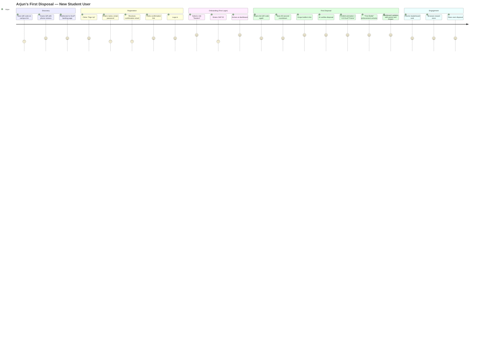
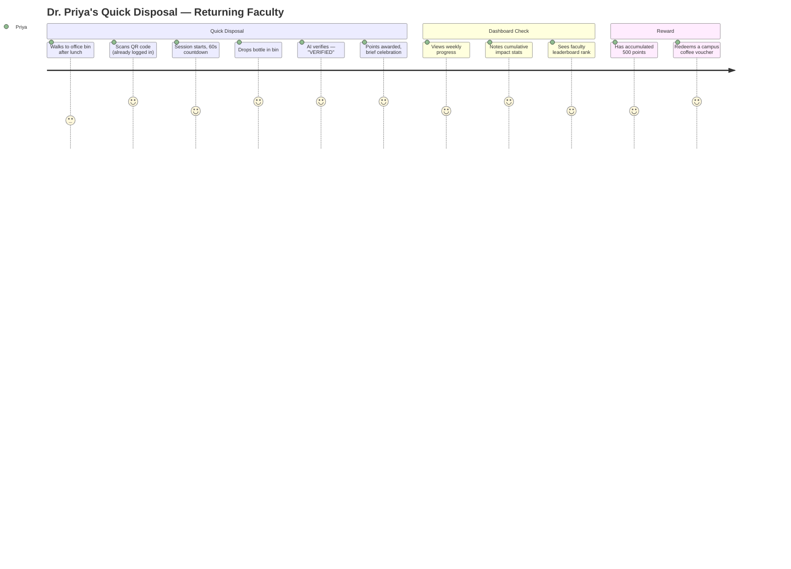
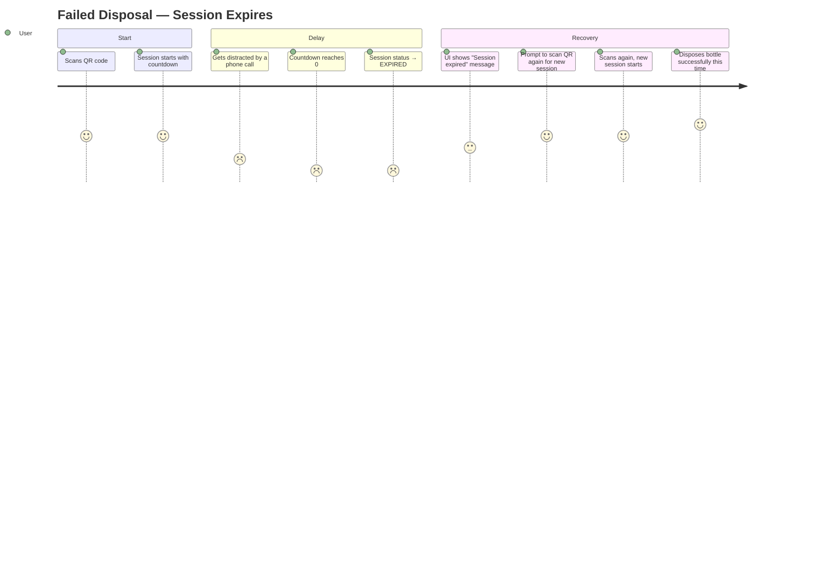
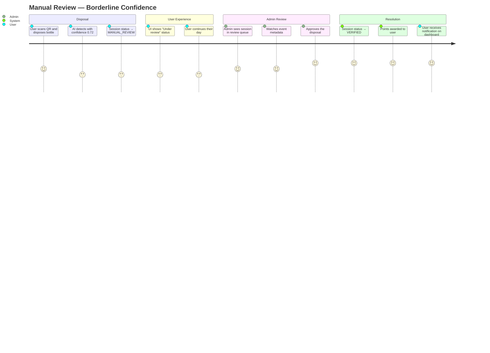
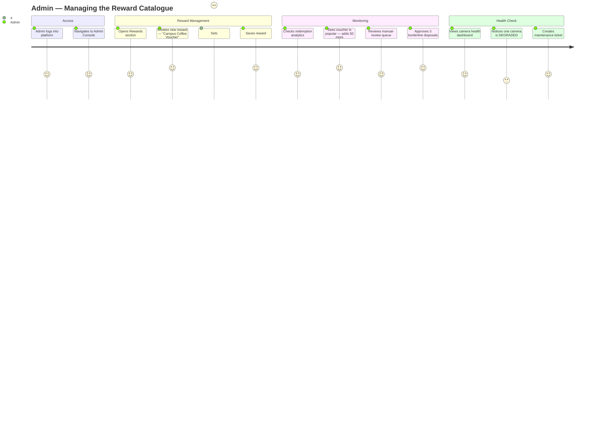

# 03 — User Personas & Journeys

> **Spec file:** `03-personas-journeys.md`  
> **Enums referenced:** `UserRole`, `SessionStatus`, `AchievementKey`, `LeaderboardSegment` — defined in [00-index.md](file:///Users/prathambhat/Desktop/EcoP/docs/spec/00-index.md)

---

## 1. Personas

### Persona 1: Arjun — The Eco-Conscious Student

| Attribute | Detail |
|-----------|--------|
| **Role** | `STUDENT` |
| **Age** | 20 |
| **Context** | 2nd-year engineering student at a large Indian university. Disposes 2–4 plastic bottles daily between classes. Uses his phone constantly. Competitive — already tracks fitness and study streaks. Has a SAP ID from enrollment. |
| **Goals** | Earn rewards while doing something good. Compete with friends on leaderboards. Build a visible track record of sustainability. Unlock all achievements. |
| **Pain Points** | Recycling feels invisible — no feedback, no proof he did it. Campus bins are unlabeled, and he doesn't know which ones are for recycling. He's skeptical about whether recyclables actually get recycled. |
| **How EcoP Serves Him** | QR scan takes <10 seconds between classes. Instant verification + point award provides immediate gratification. Leaderboard competition with peers drives daily engagement. Achievement badges give him bragging rights. Dashboard shows tangible environmental impact ("You've prevented 540g of plastic waste"). |
| **Leaderboard Visibility** | Appears in: `OVERALL`, `STUDENTS` segments. Eligible for `CAMPUS_CHAMPION` achievement. |

### Persona 2: Dr. Priya — The Sustainability-Minded Faculty

| Attribute | Detail |
|-----------|--------|
| **Role** | `FACULTY` |
| **Age** | 38 |
| **Context** | Associate professor in Environmental Science. Disposes 1–2 bottles per day (refill habit, lower volume). Deeply cares about sustainability but has limited free time. Wants to set an example for students. Has a SAP ID as a faculty member. |
| **Goals** | Model sustainable behavior for students. Track the campus's collective environmental impact. Use EcoP data in her sustainability course as a case study. Redeem rewards as a secondary benefit. |
| **Pain Points** | Feels the university's sustainability initiatives lack measurability. Doesn't have time for complex apps — needs a frictionless experience. Worries about student data privacy in any campus tech system. |
| **How EcoP Serves Her** | Simple, fast disposal flow respects her time. Dashboard's environmental impact metrics give her real data for classes. Privacy-first architecture (no face recognition, no imagery stored) addresses her concerns directly. Faculty leaderboard segment lets her engage without competing against students' higher volume. |
| **Leaderboard Visibility** | Appears in: `OVERALL`, `FACULTY` segments. |

### Persona 3: Rahul — The Campus Visitor

| Attribute | Detail |
|-----------|--------|
| **Role** | `EXTERNAL_VISITOR` |
| **Age** | 28 |
| **Context** | Visiting the university for a conference. No campus familiarity. No SAP ID. Has a plastic bottle from the campus canteen. Sees a QR code on a recycling bin and is curious. |
| **Goals** | Dispose his bottle properly. Understand what EcoP is. Maybe sign up if it's quick. Not interested in long onboarding or campus-specific features. |
| **Pain Points** | Unfamiliar with campus layout — doesn't know where recycling bins are. Doesn't want to create an account just to throw away a bottle (but needs to for the reward system). Doesn't have a SAP ID and doesn't know what one is. |
| **How EcoP Serves Him** | QR code on the bin draws attention. Registration is quick (email + password, no SAP ID required for visitors). Role selection skips the SAP ID step entirely. He gets points, sees his impact, and might continue using EcoP on return visits. Visitors segment keeps him visible without competing with regular campus users. |
| **Leaderboard Visibility** | Appears in: `OVERALL`, `VISITORS` segments. **Excluded** from `STUDENTS` and `FACULTY` segments. Not eligible for `CAMPUS_CHAMPION` achievement. |

---

## 2. User Journeys

### Journey 1: Arjun's First Disposal (New User)



### Journey 2: Dr. Priya's Routine Disposal (Returning User)



### Journey 3: Rahul's Visitor Experience

```mermaid
journey
    title Rahul's Visitor Experience — First & Only Visit
    section Discovery
      Finishes water bottle at conference: 3: Rahul
      Sees EcoP QR code on nearby bin: 4: Rahul
      Scans QR code: 4: Rahul
    section Quick Registration
      Redirected to landing page: 3: Rahul
      Clicks "Sign Up": 3: Rahul
      Enters name, email, password: 3: Rahul
      Verifies email: 3: Rahul
      Logs in: 4: Rahul
    section Onboarding
      Selects "External Visitor": 5: Rahul
      No SAP ID prompt — skipped: 5: Rahul
      Arrives at dashboard: 4: Rahul
    section Disposal
      Scans bin QR again: 4: Rahul
      60-second countdown: 3: Rahul
      Drops bottle: 5: Rahul
      Verified — "+10 EcoP Points": 5: Rahul
      Sees impact: "18g plastic waste prevented": 4: Rahul
    section Departure
      Checks visitor leaderboard — ranked #1: 5: Rahul
      May return in future visits: 3: Rahul
```

### Journey 4: Failed Disposal — Expired Session



### Journey 5: Manual Review Flow



### Journey 6: Admin Managing Rewards



---

## 3. Persona–Feature Matrix

| Feature | Arjun (Student) | Dr. Priya (Faculty) | Rahul (Visitor) |
|---------|:---:|:---:|:---:|
| Email registration | ✅ | ✅ | ✅ |
| SAP ID onboarding | ✅ | ✅ | ❌ (skipped) |
| QR disposal flow | ✅ | ✅ | ✅ |
| Points earning | ✅ | ✅ | ✅ |
| Reward redemption | ✅ | ✅ | ✅ |
| Student leaderboard | ✅ | ❌ | ❌ |
| Faculty leaderboard | ❌ | ✅ | ❌ |
| Visitor leaderboard | ❌ | ❌ | ✅ |
| Overall leaderboard | ✅ | ✅ | ✅ |
| Campus Champion achievement | ✅ | ✅ | ❌ |
| All other achievements | ✅ | ✅ | ✅ |
| Dashboard environmental impact | ✅ | ✅ | ✅ |
| Admin console | ❌ | ❌ | ❌ |
