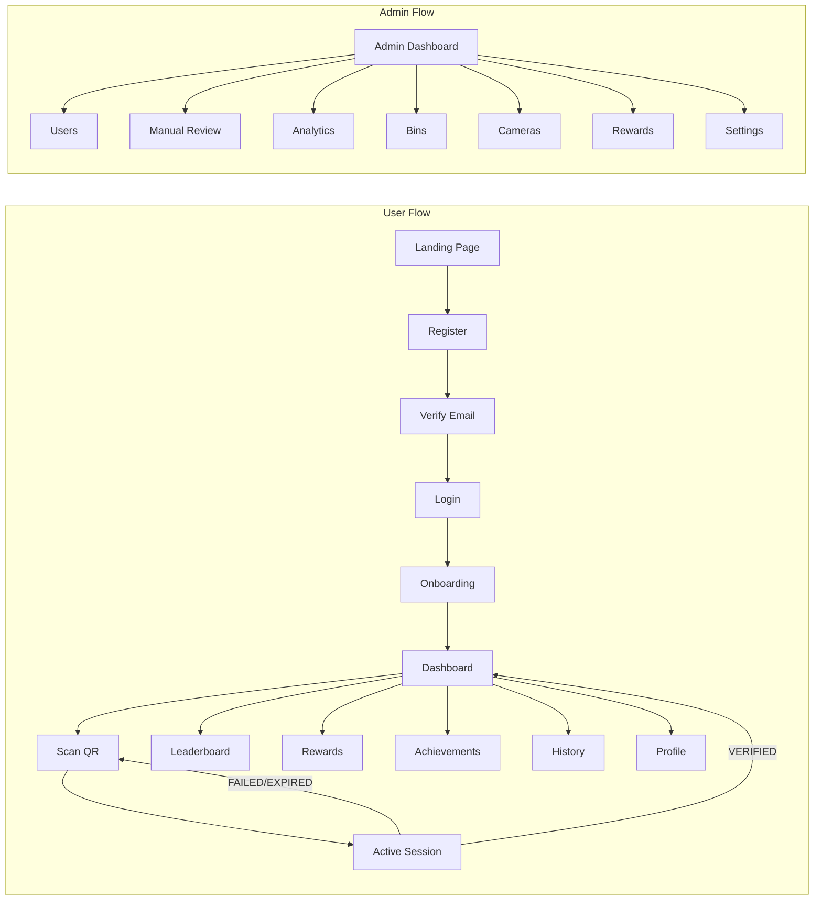

# 04 — Information Architecture

> **Spec file:** `04-information-architecture.md`  
> **Enums referenced:** `UserRole`, `LeaderboardSegment`, `LeaderboardPeriod` — defined in [00-index.md](file:///Users/prathambhat/Desktop/EcoP/docs/spec/00-index.md)

---

## 1. Site Map

```mermaid
graph TD
    ROOT["EcoP Web Application"]
    
    ROOT --> PUBLIC["Public Pages (No Auth)"]
    ROOT --> AUTH["Auth Pages"]
    ROOT --> PROTECTED["Protected Pages (Auth Required)"]
    ROOT --> ADMIN_SECTION["Admin Console (ADMIN Role)"]
    
    PUBLIC --> LANDING["/  — Landing Page"]
    PUBLIC --> ABOUT["/about — About EcoP"]
    PUBLIC --> PRIVACY["/privacy — Privacy Policy"]
    PUBLIC --> TERMS["/terms — Terms of Service"]
    
    AUTH --> LOGIN["/login — Login"]
    AUTH --> REGISTER["/register — Register"]
    AUTH --> VERIFY_EMAIL["/verify-email — Email Verification"]
    AUTH --> FORGOT["/forgot-password — Forgot Password"]
    AUTH --> RESET["/reset-password — Reset Password"]
    AUTH --> ONBOARDING["/onboarding — First-Login Onboarding"]
    
    PROTECTED --> DASHBOARD["/dashboard — User Dashboard"]
    PROTECTED --> SCAN["/scan — QR Scan / Session"]
    PROTECTED --> SESSION["/session/:id — Active Session"]
    PROTECTED --> LEADERBOARD["/leaderboard — Leaderboards"]
    PROTECTED --> REWARDS["/rewards — Reward Store"]
    PROTECTED --> ACHIEVEMENTS["/achievements — My Achievements"]
    PROTECTED --> PROFILE["/profile — Profile Settings"]
    PROTECTED --> HISTORY["/history — Disposal History"]
    
    ADMIN_SECTION --> ADMIN_DASH["/admin — Admin Dashboard"]
    ADMIN_SECTION --> ADMIN_USERS["/admin/users — User Management"]
    ADMIN_SECTION --> ADMIN_BINS["/admin/bins — Bin Management"]
    ADMIN_SECTION --> ADMIN_CAMERAS["/admin/cameras — Camera Health"]
    ADMIN_SECTION --> ADMIN_SESSIONS["/admin/sessions — Session Browser"]
    ADMIN_SECTION --> ADMIN_EVENTS["/admin/events — Waste Events"]
    ADMIN_SECTION --> ADMIN_REVIEW["/admin/review — Manual Review Queue"]
    ADMIN_SECTION --> ADMIN_REWARDS["/admin/rewards — Reward Management"]
    ADMIN_SECTION --> ADMIN_POINTS["/admin/points — Point Rules"]
    ADMIN_SECTION --> ADMIN_ACHIEVEMENTS["/admin/achievements — Achievement Config"]
    ADMIN_SECTION --> ADMIN_ANALYTICS["/admin/analytics — Analytics"]
    ADMIN_SECTION --> ADMIN_SETTINGS["/admin/settings — System Settings"]
    ADMIN_SECTION --> ADMIN_FAILED["/admin/failed-events — Failed Events"]
    ADMIN_SECTION --> ADMIN_FLAGS["/admin/flags — Flagged Users"]
```



## 2. Page Hierarchy & Access Control

| Route | Page Title | Auth | Role | Parent |
|-------|-----------|------|------|--------|
| `/` | Landing Page | None | Any | — |
| `/about` | About EcoP | None | Any | Landing |
| `/privacy` | Privacy Policy | None | Any | Landing |
| `/terms` | Terms of Service | None | Any | Landing |
| `/login` | Log In | None (redirect if authed) | Any | — |
| `/register` | Create Account | None (redirect if authed) | Any | — |
| `/verify-email` | Verify Email | None | Any | Register |
| `/forgot-password` | Forgot Password | None | Any | Login |
| `/reset-password` | Reset Password | None (token required) | Any | Forgot Password |
| `/onboarding` | Welcome Setup | Required (first login only) | Non-Admin | — |
| `/dashboard` | My Dashboard | Required | Non-Admin | — |
| `/scan` | Scan QR Code | Required | Non-Admin | Dashboard |
| `/session/:id` | Active Session | Required (session owner) | Non-Admin | Scan |
| `/leaderboard` | Leaderboards | Required | Non-Admin | Dashboard |
| `/rewards` | Reward Store | Required | Non-Admin | Dashboard |
| `/achievements` | My Achievements | Required | Non-Admin | Dashboard |
| `/profile` | Profile & Settings | Required | Non-Admin | Dashboard |
| `/history` | Disposal History | Required | Non-Admin | Dashboard |
| `/admin` | Admin Dashboard | Required | `ADMIN` | — |
| `/admin/users` | User Management | Required | `ADMIN` | Admin |
| `/admin/bins` | Bin Management | Required | `ADMIN` | Admin |
| `/admin/cameras` | Camera Health | Required | `ADMIN` | Admin |
| `/admin/sessions` | Session Browser | Required | `ADMIN` | Admin |
| `/admin/events` | Waste Events | Required | `ADMIN` | Admin |
| `/admin/review` | Manual Review Queue | Required | `ADMIN` | Admin |
| `/admin/rewards` | Reward Catalogue | Required | `ADMIN` | Admin |
| `/admin/points` | Point Rules | Required | `ADMIN` | Admin |
| `/admin/achievements` | Achievement Config | Required | `ADMIN` | Admin |
| `/admin/analytics` | Analytics | Required | `ADMIN` | Admin |
| `/admin/settings` | System Settings | Required | `ADMIN` | Admin |
| `/admin/failed-events` | Failed Events | Required | `ADMIN` | Admin |
| `/admin/flags` | Flagged Users | Required | `ADMIN` | Admin |

## 3. Navigation Structure

### 3.1 Public Navigation (Top Bar)

```
┌──────────────────────────────────────────────────────────────┐
│  [EcoP Logo]     How It Works   About   Impact     [Log In] [Sign Up] │
└──────────────────────────────────────────────────────────────┘
```

- Logo links to `/`.
- "How It Works," "About," "Impact" are anchor links within the landing page.
- "Log In" → `/login`, "Sign Up" → `/register`.
- On mobile: hamburger menu with the same items.

### 3.2 Authenticated Navigation (Sidebar on Desktop, Bottom Tab Bar on Mobile)

**Desktop Sidebar:**

```
┌──────────────────┐
│  [EcoP Logo]     │
│                  │
│  📊 Dashboard    │
│  📸 Scan QR      │
│  🏆 Leaderboard  │
│  🎁 Rewards      │
│  🏅 Achievements │
│  📋 History      │
│                  │
│  ──────────────  │
│  👤 Profile      │
│  🚪 Log Out      │
│                  │
│  [Admin Console] │  ← Only visible for ADMIN role
└──────────────────┘
```

**Mobile Bottom Tab Bar:**

```
┌──────────────────────────────────────────┐
│  Dashboard │ Scan │ Leaderboard │ More   │
│     📊     │  📸  │     🏆      │  ···   │
└──────────────────────────────────────────┘
```

"More" expands to: Rewards, Achievements, History, Profile, Log Out, Admin Console (if admin).

### 3.3 Admin Navigation (Sidebar)

```
┌──────────────────────┐
│  [EcoP Admin]        │
│                      │
│  📊 Overview         │
│  👥 Users            │
│  🗑️ Bins             │
│  📹 Cameras          │
│  📋 Sessions         │
│  📡 Waste Events     │
│  ⚠️ Manual Review    │
│  🎁 Rewards          │
│  💰 Point Rules      │
│  🏅 Achievements     │
│  📈 Analytics        │
│  ⚙️ Settings         │
│  ❌ Failed Events    │
│  🚩 Flagged Users    │
│                      │
│  ──────────────────  │
│  ← Back to Platform  │
│  🚪 Log Out          │
└──────────────────────┘
```

## 4. Information Flow



## 5. URL Query Parameters

| Route | Parameter | Purpose |
|-------|-----------|---------|
| `/scan` | `?bin=ECOP-BIN-LIBRARY` | Pre-fill bin code from QR scan deep link |
| `/leaderboard` | `?segment=STUDENTS&period=WEEKLY` | Pre-select leaderboard view |
| `/admin/sessions` | `?status=MANUAL_REVIEW` | Filter sessions by status |
| `/admin/users` | `?flagged=true` | Show only flagged users |
| `/verify-email` | `?token=<jwt>` | Email verification token |
| `/reset-password` | `?token=<jwt>` | Password reset token |

## 6. Redirects & Guards

| Condition | Redirect To |
|-----------|-------------|
| Unauthenticated user visits protected route | `/login?redirect=<original_path>` |
| Authenticated user visits `/login` or `/register` | `/dashboard` |
| Authenticated user has not completed onboarding | `/onboarding` |
| Non-admin visits `/admin/*` | `/dashboard` with toast "Insufficient permissions" |
| Session owner mismatch on `/session/:id` | `/dashboard` with toast "Session not found" |
