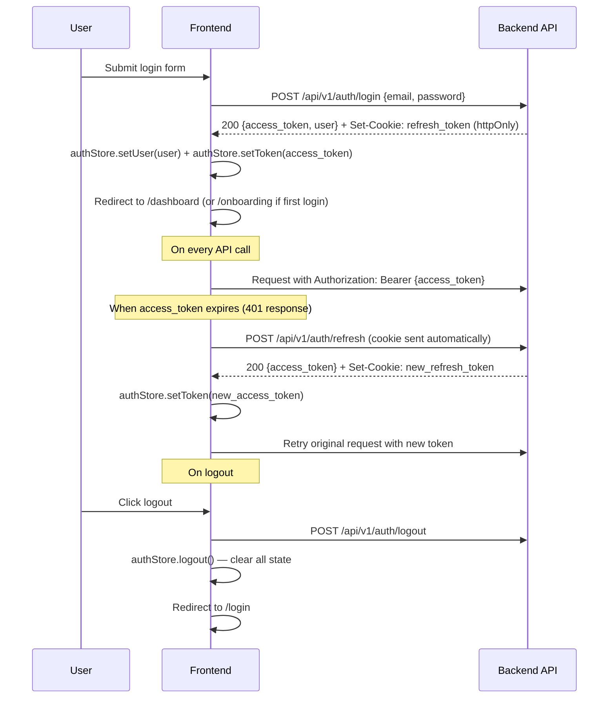

# 07 — Frontend Architecture

> **Spec file:** `07-frontend-architecture.md`  
> **Enums referenced:** `UserRole`, `SessionStatus`, `LeaderboardSegment`, `LeaderboardPeriod` — defined in [00-index.md](file:///Users/prathambhat/Desktop/EcoP/docs/spec/00-index.md)  
> **Component tree:** See [06-component-hierarchy.md](file:///Users/prathambhat/Desktop/EcoP/docs/spec/06-component-hierarchy.md)

---

## 1. Tech Stack (Pinned Versions)

| Technology | Version | Purpose |
|-----------|---------|---------|
| Next.js | 15.x (App Router) | Framework — SSR, routing, API proxy |
| React | 18.x | UI library |
| TypeScript | 5.x (strict mode) | Type safety |
| Tailwind CSS | 3.4.x | Utility-first styling |
| shadcn/ui | latest | Component primitives (built on Radix UI) |
| Framer Motion | 11.x | Page transitions, UI animations |
| Zustand | 5.x | Client/UI state management |
| TanStack Query (React Query) | 5.x | Server state, caching, background refetching |
| Zod | 3.x | Runtime schema validation (forms, API responses) |
| canvas-confetti | 1.x | Confetti celebration effect |
| html5-qrcode | 2.x | QR code scanning via browser camera |
| react-hook-form | 7.x | Form state management with Zod integration |
| next-themes | 0.x | Dark/light mode toggle |
| recharts | 2.x | Dashboard and admin analytics charts |

---

## 2. Folder Structure

```
ecop-platform/
├── public/
│   ├── favicon.ico
│   ├── og-image.png
│   └── illustrations/           — Static SVG/PNG illustrations
│
├── src/
│   ├── app/                      — Next.js App Router
│   │   ├── layout.tsx            — RootLayout (fonts, metadata, providers)
│   │   ├── page.tsx              — Landing page (/)
│   │   ├── about/page.tsx
│   │   ├── privacy/page.tsx
│   │   ├── terms/page.tsx
│   │   │
│   │   ├── (auth)/               — Auth route group (AuthLayout)
│   │   │   ├── layout.tsx
│   │   │   ├── login/page.tsx
│   │   │   ├── register/page.tsx
│   │   │   ├── verify-email/page.tsx
│   │   │   ├── forgot-password/page.tsx
│   │   │   └── reset-password/page.tsx
│   │   │
│   │   ├── (app)/                — Authenticated route group (AppLayout)
│   │   │   ├── layout.tsx
│   │   │   ├── onboarding/page.tsx
│   │   │   ├── dashboard/page.tsx
│   │   │   ├── scan/page.tsx
│   │   │   ├── session/[id]/page.tsx
│   │   │   ├── leaderboard/page.tsx
│   │   │   ├── rewards/page.tsx
│   │   │   ├── achievements/page.tsx
│   │   │   ├── profile/page.tsx
│   │   │   └── history/page.tsx
│   │   │
│   │   ├── (admin)/              — Admin route group (AdminLayout)
│   │   │   ├── layout.tsx
│   │   │   ├── admin/page.tsx
│   │   │   ├── admin/users/page.tsx
│   │   │   ├── admin/bins/page.tsx
│   │   │   ├── admin/cameras/page.tsx
│   │   │   ├── admin/sessions/page.tsx
│   │   │   ├── admin/events/page.tsx
│   │   │   ├── admin/review/page.tsx
│   │   │   ├── admin/rewards/page.tsx
│   │   │   ├── admin/points/page.tsx
│   │   │   ├── admin/achievements/page.tsx
│   │   │   ├── admin/analytics/page.tsx
│   │   │   ├── admin/settings/page.tsx
│   │   │   ├── admin/failed-events/page.tsx
│   │   │   └── admin/flags/page.tsx
│   │   │
│   │   └── api/                  — Next.js API routes (BFF proxy only)
│   │       └── auth/
│   │           └── refresh/route.ts  — Proxy refresh-token rotation
│   │
│   ├── components/               — Shared components (see 06-component-hierarchy.md)
│   │   ├── layout/
│   │   ├── navigation/
│   │   ├── ui/
│   │   ├── feedback/
│   │   ├── data-display/
│   │   └── effects/
│   │
│   ├── features/                 — Feature-specific components
│   │   ├── auth/
│   │   │   ├── LoginForm.tsx
│   │   │   ├── RegisterForm.tsx
│   │   │   ├── ForgotPasswordForm.tsx
│   │   │   ├── ResetPasswordForm.tsx
│   │   │   └── OnboardingWizard.tsx
│   │   ├── dashboard/
│   │   │   ├── ProfileCard.tsx
│   │   │   ├── PointsCard.tsx
│   │   │   ├── EnvironmentalImpactCard.tsx
│   │   │   ├── ActiveSessionCard.tsx
│   │   │   ├── WeeklyProgressCard.tsx
│   │   │   ├── RecentHistoryCard.tsx
│   │   │   ├── LeaderboardPreviewCard.tsx
│   │   │   ├── AchievementsPreviewCard.tsx
│   │   │   └── NearbyBinsCard.tsx
│   │   ├── disposal/
│   │   │   ├── QRScanner.tsx
│   │   │   ├── ManualEntryForm.tsx
│   │   │   ├── SessionView.tsx
│   │   │   └── CountdownRing.tsx
│   │   ├── leaderboard/
│   │   │   ├── SegmentTabs.tsx
│   │   │   ├── PeriodPills.tsx
│   │   │   ├── PodiumDisplay.tsx
│   │   │   ├── RankingsTable.tsx
│   │   │   └── UserRankCard.tsx
│   │   ├── rewards/
│   │   │   ├── RewardCard.tsx
│   │   │   ├── RewardsGrid.tsx
│   │   │   └── RedemptionDialog.tsx
│   │   ├── achievements/
│   │   │   ├── AchievementBadge.tsx
│   │   │   └── AchievementsGrid.tsx
│   │   ├── landing/
│   │   │   ├── HeroSection.tsx
│   │   │   ├── LiveStatsBar.tsx
│   │   │   ├── HowItWorksSection.tsx
│   │   │   ├── AboutAISection.tsx
│   │   │   ├── EnvironmentalImpactSection.tsx
│   │   │   ├── RewardsPreviewSection.tsx
│   │   │   ├── LeaderboardPreviewSection.tsx
│   │   │   └── CTASection.tsx
│   │   └── admin/
│   │       ├── AdminDashboard.tsx
│   │       ├── UserManagement.tsx
│   │       ├── BinManagement.tsx
│   │       ├── CameraHealth.tsx
│   │       ├── ReviewQueue.tsx
│   │       ├── RewardManagement.tsx
│   │       ├── PointRulesEditor.tsx
│   │       ├── AnalyticsCharts.tsx
│   │       ├── SettingsForm.tsx
│   │       ├── FailedEvents.tsx
│   │       └── FlaggedUsers.tsx
│   │
│   ├── hooks/                    — Custom React hooks
│   │   ├── useAuth.ts            — Authentication state + actions
│   │   ├── useSSE.ts             — SSE connection management
│   │   ├── useCountdown.ts       — Countdown timer logic
│   │   ├── useMediaQuery.ts      — Responsive breakpoint detection
│   │   └── useIntersection.ts    — IntersectionObserver for scroll animations
│   │
│   ├── stores/                   — Zustand stores (client state only)
│   │   ├── authStore.ts          — Auth state: user, token, isAuthenticated
│   │   ├── sessionStore.ts       — Active disposal session state
│   │   ├── themeStore.ts         — Dark/light mode preference
│   │   └── uiStore.ts            — UI state: sidebar open, modals, toasts
│   │
│   ├── services/                 — API client layer
│   │   ├── apiClient.ts          — Axios/fetch wrapper with auth interceptor
│   │   ├── authService.ts        — Login, register, refresh, reset
│   │   ├── sessionService.ts     — Create/get disposal sessions
│   │   ├── rewardService.ts      — List/redeem rewards
│   │   ├── leaderboardService.ts — Get leaderboard data
│   │   ├── achievementService.ts — Get user achievements
│   │   ├── statsService.ts       — Public/user statistics
│   │   ├── adminService.ts       — Admin CRUD operations
│   │   └── sseService.ts         — SSE connection for real-time updates
│   │
│   ├── queries/                  — TanStack Query hooks
│   │   ├── useUser.ts
│   │   ├── useDashboard.ts
│   │   ├── useDisposalSessions.ts
│   │   ├── useLeaderboard.ts
│   │   ├── useRewards.ts
│   │   ├── useAchievements.ts
│   │   ├── useStatistics.ts
│   │   └── useAdmin.ts
│   │
│   ├── lib/                      — Utilities
│   │   ├── constants.ts          — App-wide constants
│   │   ├── utils.ts              — General utility functions
│   │   ├── formatters.ts         — Number, date, points formatting
│   │   ├── validators.ts         — Zod schemas for forms
│   │   └── cn.ts                 — Tailwind class merge utility
│   │
│   ├── types/                    — TypeScript type definitions
│   │   ├── api.ts                — API response/request types
│   │   ├── models.ts             — Domain model interfaces
│   │   └── enums.ts              — TypeScript enums mirroring backend
│   │
│   └── styles/
│       └── globals.css           — Tailwind directives + custom CSS vars
│
├── tailwind.config.ts            — Tailwind configuration (design tokens)
├── next.config.ts                — Next.js configuration
├── tsconfig.json                 — TypeScript config (strict: true)
├── .env.local                    — Environment variables (not committed)
├── .env.example                  — Template for required env vars
└── package.json
```

---

## 3. State Management Strategy

### 3.1 Client State (Zustand)

Zustand manages **transient UI state** that doesn't come from the server:

| Store | State | Actions |
|-------|-------|---------|
| `authStore` | `user: User \| null`, `accessToken: string \| null`, `isAuthenticated: boolean`, `isOnboarded: boolean` | `setUser()`, `setToken()`, `logout()`, `completeOnboarding()` |
| `sessionStore` | `activeSession: DisposalSession \| null`, `countdown: number` | `setSession()`, `updateStatus()`, `tick()`, `clearSession()` |
| `themeStore` | `theme: 'light' \| 'dark' \| 'system'` | `setTheme()` |
| `uiStore` | `sidebarOpen: boolean`, `activeModal: string \| null`, `toasts: Toast[]` | `toggleSidebar()`, `openModal()`, `closeModal()`, `addToast()`, `removeToast()` |

### 3.2 Server State (TanStack Query)

TanStack Query manages **all data fetched from the backend API**:

| Query Key | Endpoint | Stale Time | Refetch Strategy |
|-----------|----------|------------|------------------|
| `['user', 'me']` | `GET /api/v1/users/me` | 5 min | On window focus |
| `['dashboard']` | `GET /api/v1/users/me/dashboard` | 30s | On window focus + SSE invalidation |
| `['sessions', filters]` | `GET /api/v1/sessions` | 1 min | On window focus |
| `['leaderboard', segment, period]` | `GET /api/v1/leaderboard` | 15 min (matches precompute interval) | Manual |
| `['rewards']` | `GET /api/v1/rewards` | 5 min | On window focus |
| `['achievements']` | `GET /api/v1/users/me/achievements` | 5 min | SSE invalidation on new unlock |
| `['statistics']` | `GET /api/v1/statistics` | 5 min (matches cache refresh) | On window focus |
| `['admin', resource, filters]` | `GET /api/v1/admin/*` | 1 min | On window focus |

**Mutations** (TanStack Query `useMutation`):
- `createSession` → optimistic UI (start countdown immediately, roll back on error).
- `redeemReward` → optimistic balance update, roll back on error.
- Admin CRUD operations → invalidate related query keys on success.

### 3.3 Real-Time State (SSE)

**SSE Connection:** Managed by `useSSE` hook, connected when user is on `/dashboard` or `/session/:id`.

**Endpoint:** `GET /api/v1/sse/sessions/:session_id` (session-specific) and `GET /api/v1/sse/user` (user-wide notifications).

**Events received:**

| Event Type | Payload | Action |
|------------|---------|--------|
| `session.status_changed` | `{ session_id, status, confidence? }` | Update `sessionStore`, invalidate `['dashboard']` query |
| `session.verified` | `{ session_id, points_awarded }` | Trigger confetti, update points in `authStore`, invalidate `['dashboard']` |
| `achievement.unlocked` | `{ achievement_key, unlocked_at }` | Trigger achievement animation, invalidate `['achievements']` |
| `points.updated` | `{ new_balance }` | Update points display with animated counter |

---

## 4. Authentication Flow (Frontend)



### Token Refresh Strategy
- The `apiClient` interceptor catches 401 responses.
- On 401 with `TOKEN_EXPIRED` error code: automatically attempt refresh.
- If refresh fails (refresh token expired): clear auth state, redirect to `/login`.
- Concurrent requests during refresh are queued and retried after refresh completes (token refresh lock pattern).

---

## 5. Route Protection

### Middleware (Next.js `middleware.ts`)

```
Middleware logic (pseudocode, not implementation):

1. Check if route is public → allow
2. Check if route is auth-only (/login, /register) and user is authenticated → redirect to /dashboard
3. Check if route is protected and user is NOT authenticated → redirect to /login?redirect={path}
4. Check if route is /admin/* and user role ≠ ADMIN → redirect to /dashboard
5. Check if user is authenticated but not onboarded → redirect to /onboarding
6. Otherwise → allow
```

### Client-Side Guards
- `AuthGuard` wrapper component checks `authStore.isAuthenticated`.
- `AdminGuard` wrapper checks `authStore.user.role === 'ADMIN'`.
- `OnboardingGuard` checks `authStore.isOnboarded`.

---

## 6. API Client Configuration

| Config | Value |
|--------|-------|
| Base URL | `process.env.NEXT_PUBLIC_API_URL` (e.g., `https://api.ecop.dev/api/v1`) |
| Timeout | 10 seconds |
| Retry | 1 automatic retry on network error (not on 4xx/5xx) |
| Headers | `Authorization: Bearer {token}`, `Content-Type: application/json` |
| Cookies | `credentials: 'include'` for refresh token cookie |
| Error handling | Interceptor maps API error responses to typed `ApiError` objects |

---

## 7. Environment Variables

```
# .env.example
NEXT_PUBLIC_API_URL=http://localhost:8000/api/v1
NEXT_PUBLIC_SSE_URL=http://localhost:8000/api/v1/sse
NEXT_PUBLIC_APP_NAME=EcoP
NEXT_PUBLIC_APP_URL=http://localhost:3000
```
