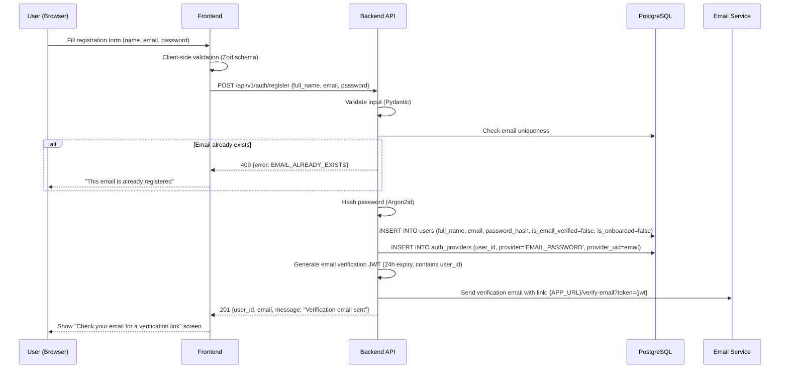
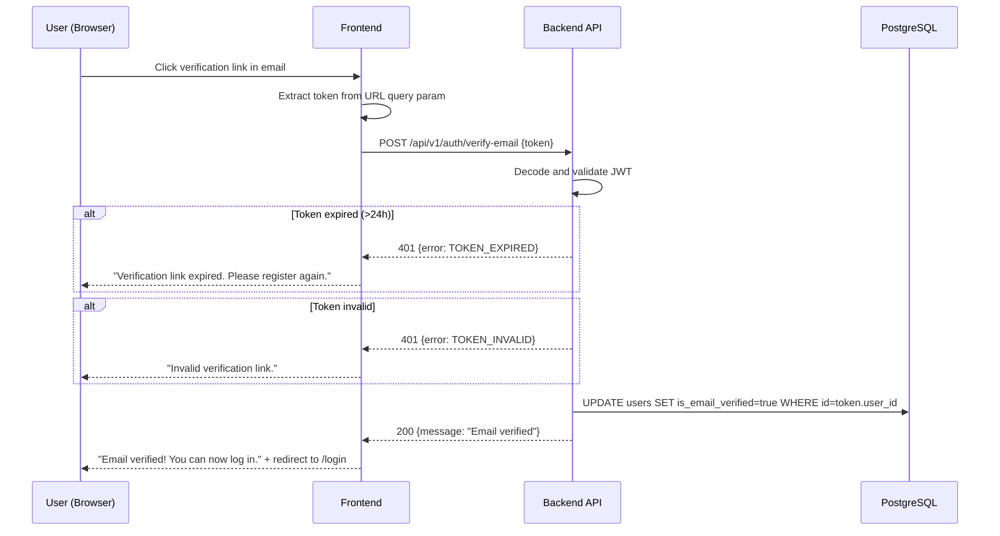
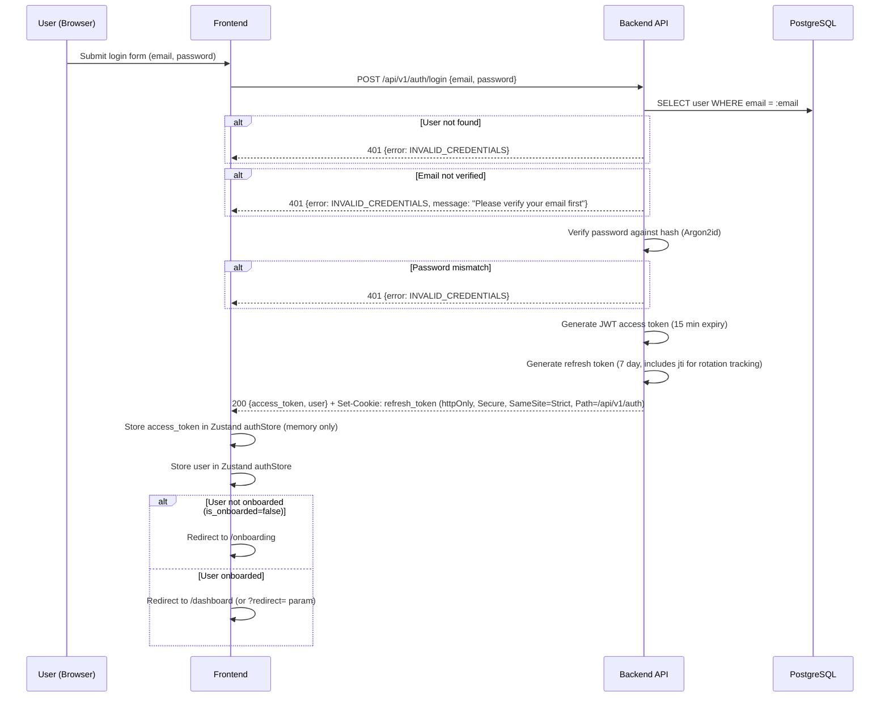
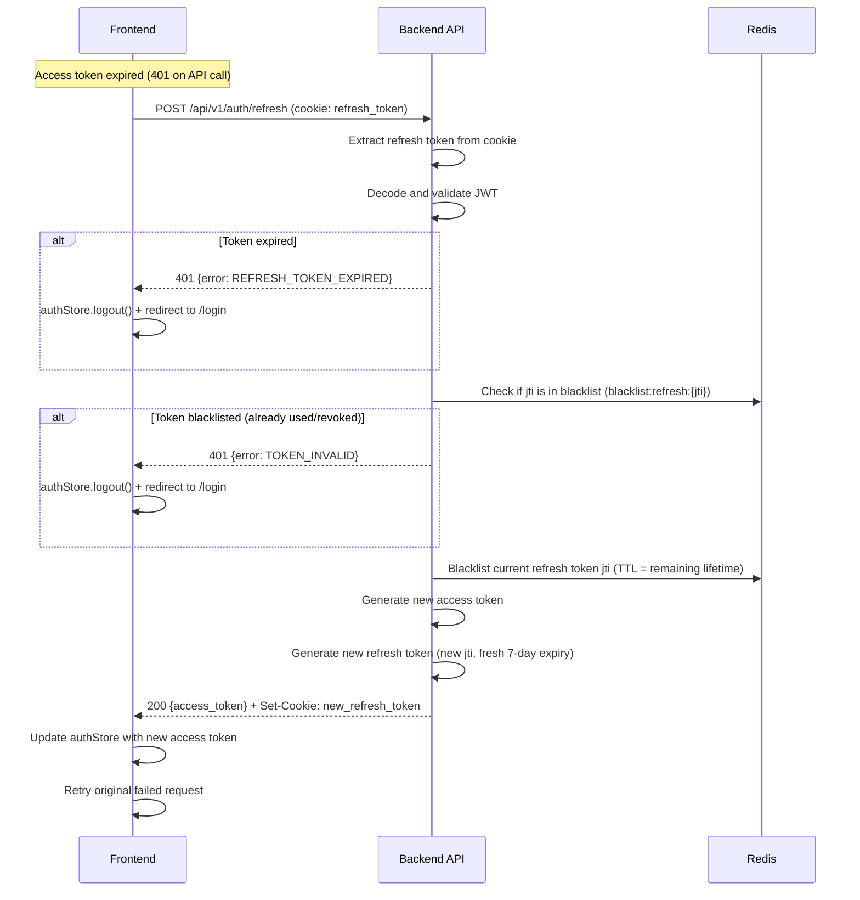
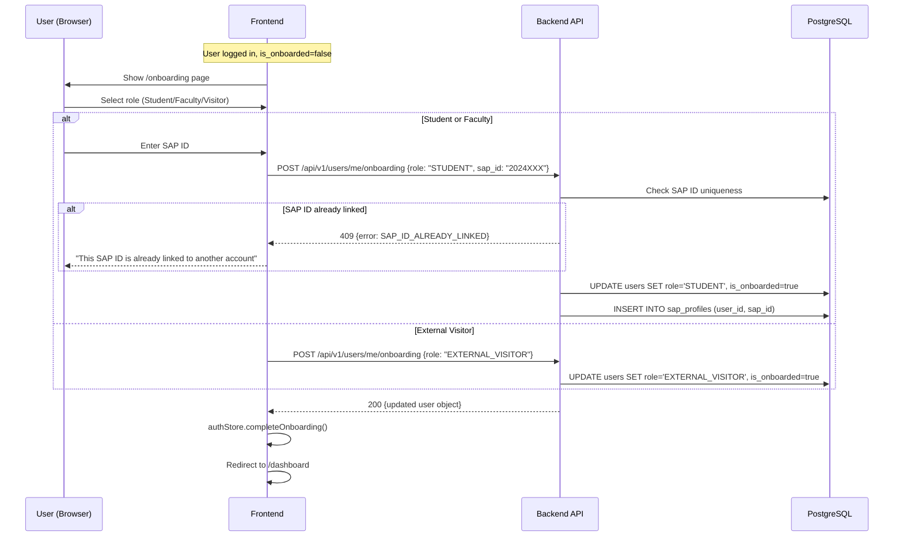
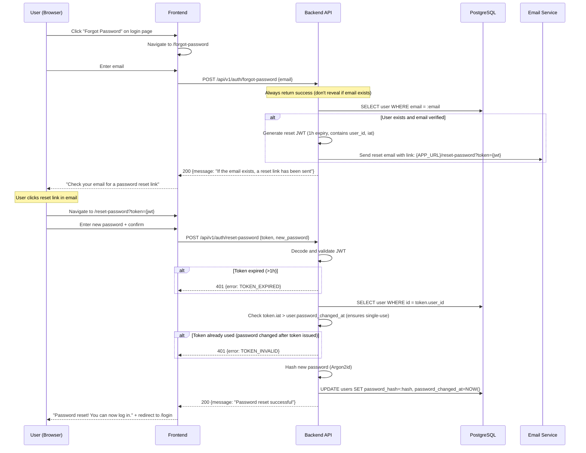
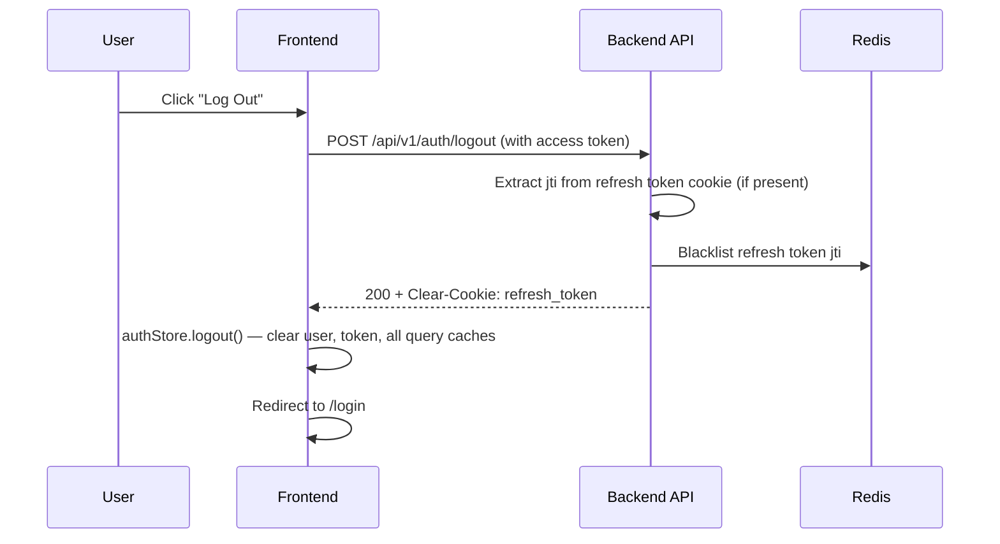
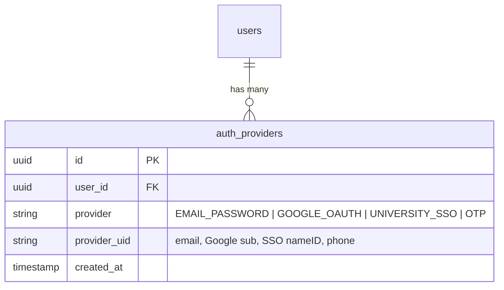

# 11 — Authentication Flow

> **Spec file:** `11-auth-flow.md`  
> **Enums referenced:** `UserRole`, `AuthProvider`, `ErrorCode` — defined in [00-index.md](file:///Users/prathambhat/Desktop/EcoP/docs/spec/00-index.md)  
> **API endpoints:** See [10-api-design.md](file:///Users/prathambhat/Desktop/EcoP/docs/spec/10-api-design.md) §1  
> **Database tables:** `users`, `sap_profiles`, `auth_providers` — see [09-database-schema.md](file:///Users/prathambhat/Desktop/EcoP/docs/spec/09-database-schema.md)

---

## 1. Registration Flow



### Registration Validation Rules

| Field | Rule |
|-------|------|
| `full_name` | Required, 2–100 characters, trimmed |
| `email` | Required, valid email format, lowercase, trimmed |
| `password` | Required, ≥8 characters, ≥1 uppercase, ≥1 lowercase, ≥1 digit, ≥1 special character (`!@#$%^&*()-_+=`) |

---

## 2. Email Verification Flow



---

## 3. Login Flow



### JWT Access Token Claims

```json
{
  "sub": "user-uuid",
  "email": "arjun@university.edu",
  "role": "STUDENT",
  "iat": 1722168600,
  "exp": 1722169500,
  "jti": "unique-token-id"
}
```

### Refresh Token Claims

```json
{
  "sub": "user-uuid",
  "jti": "unique-refresh-token-id",
  "iat": 1722168600,
  "exp": 1722773400,
  "type": "refresh"
}
```

### Cookie Properties

| Property | Value |
|----------|-------|
| Name | `ecop_refresh_token` |
| httpOnly | `true` |
| Secure | `true` (HTTPS only) |
| SameSite | `Strict` |
| Path | `/api/v1/auth` (only sent to auth endpoints) |
| Max-Age | `604800` (7 days in seconds) |

---

## 4. Token Refresh Flow



### Token Rotation Security

- **One-time use:** Each refresh token can be used exactly once. After use, its `jti` is added to a Redis blacklist.
- **Blacklist TTL:** Set to the remaining lifetime of the token (if a token had 3 days left when used, the blacklist entry lives for 3 days).
- **Stolen token detection:** If a blacklisted `jti` is presented, it means the token was already used — potentially by an attacker. The response is `TOKEN_INVALID` and the user must re-authenticate.

---

## 5. Onboarding Flow (First Login)



---

## 6. Password Reset Flow



### Single-Use Enforcement

Instead of maintaining a separate `password_reset_tokens` table, the `password_changed_at` column on `users` is compared against the token's `iat` (issued-at) claim. If `iat < password_changed_at`, the token was issued before the last password change and is no longer valid. This makes reset tokens implicitly single-use without additional storage.

---

## 7. Logout Flow



---

## 8. Auth Provider Extension Points (V2+)

The `auth_providers` table is designed to support multiple authentication providers per user without a schema change:



**V2 additions require only:**
1. New rows in `auth_providers` for each provider a user connects.
2. New auth route handlers (e.g., `/auth/google/callback`).
3. No schema migration needed for the core `users` table.

**V1 state:** Each user has exactly one `auth_providers` row with `provider='EMAIL_PASSWORD'` and `provider_uid=<their email>`.

---

## 9. Security Summary

| Concern | Implementation |
|---------|---------------|
| Password storage | Argon2id hash via passlib (bcrypt fallback) |
| Access token | JWT, 15 min expiry, Bearer header |
| Refresh token | JWT, 7 day expiry, httpOnly + Secure + SameSite=Strict cookie |
| Token rotation | Refresh tokens are one-time use, blacklisted in Redis after use |
| CSRF protection | SameSite=Strict cookie + token not accessible to JavaScript |
| Brute-force protection | Rate limiting on `/auth/login` (10 attempts/min per IP) |
| Email enumeration | `/forgot-password` always returns success regardless of email existence |
| Password reset | Signed JWT, 1h expiry, implicitly single-use via `password_changed_at` check |
| Role escalation | `ADMIN` role never self-selectable; granted only by existing admin via admin endpoint |
