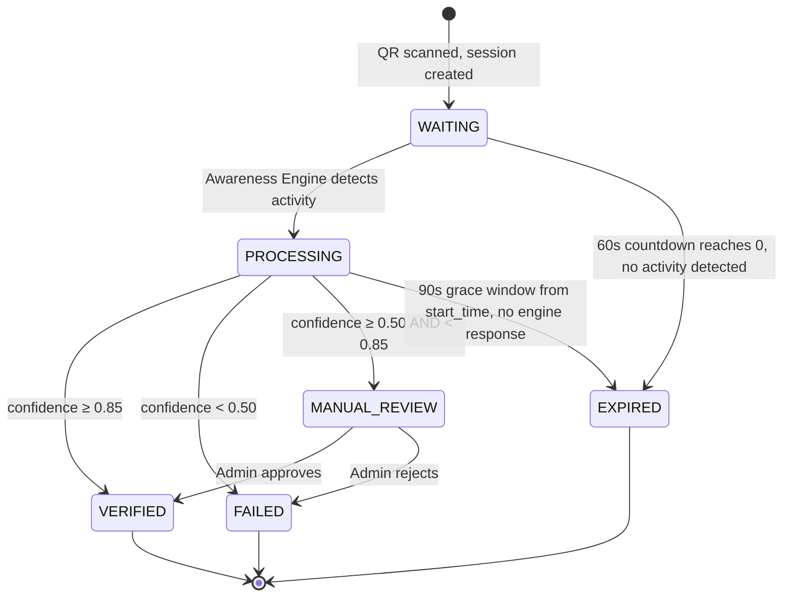
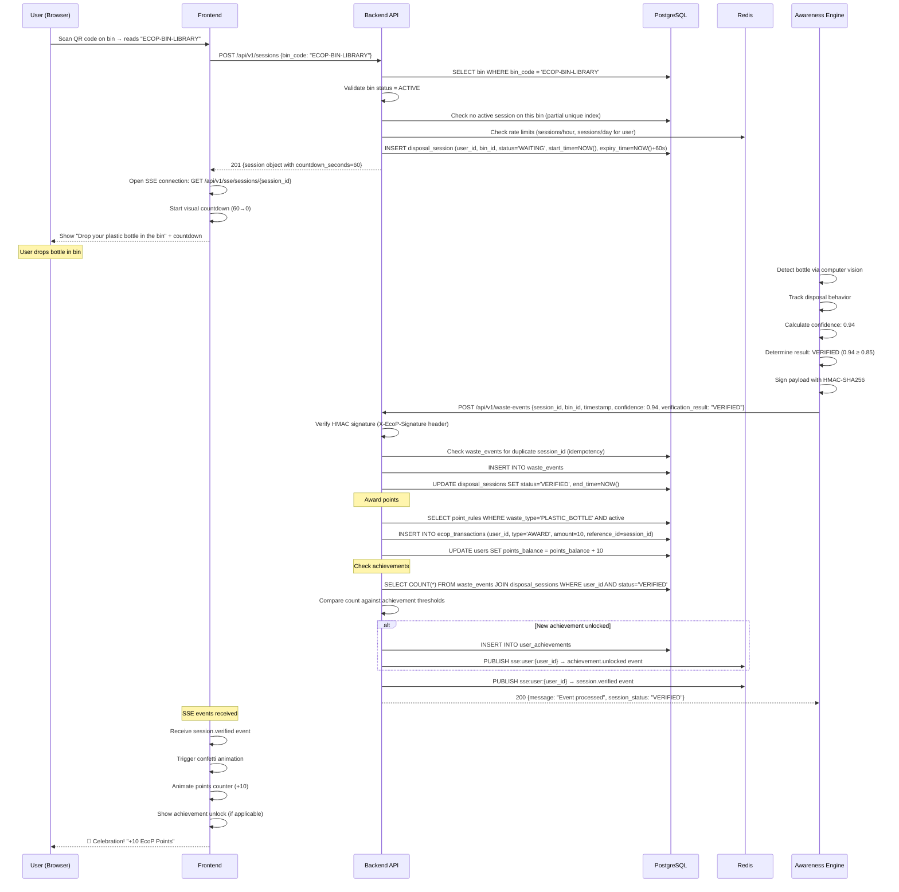
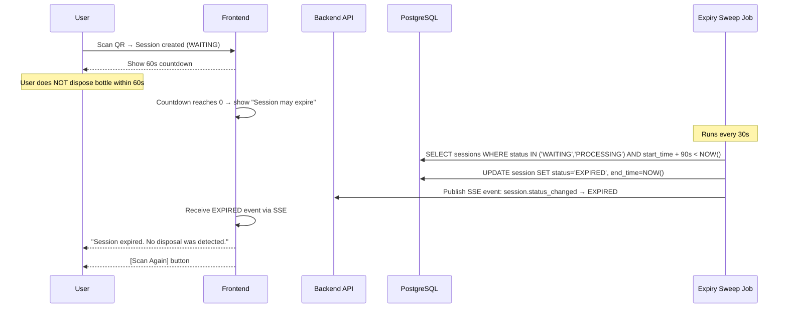
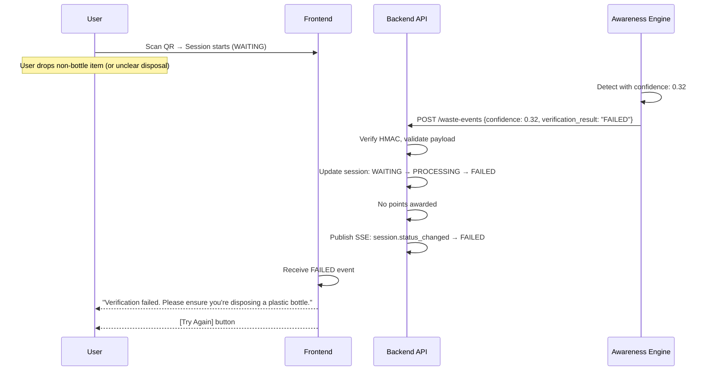
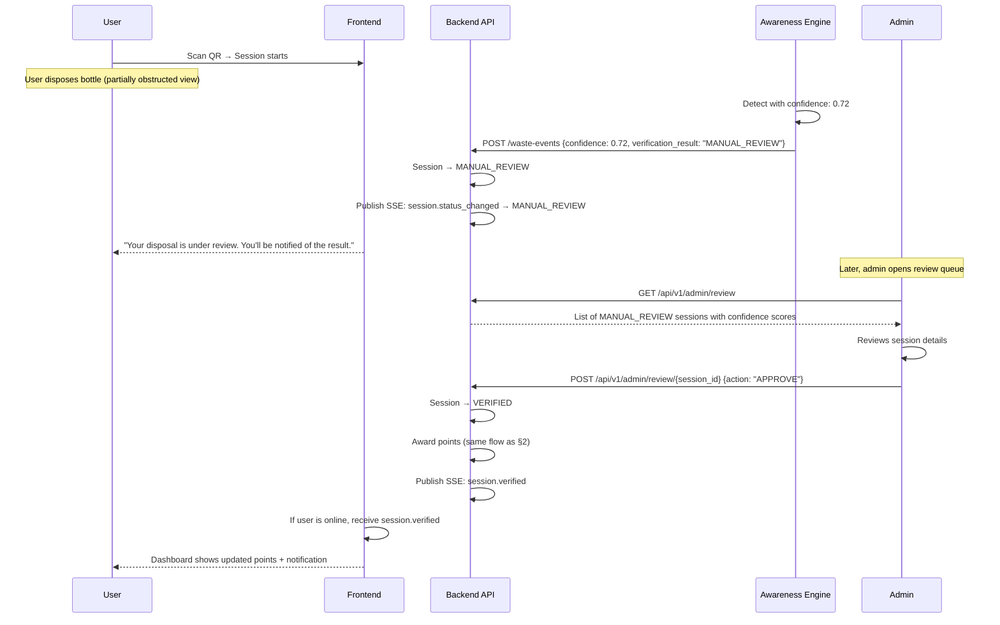
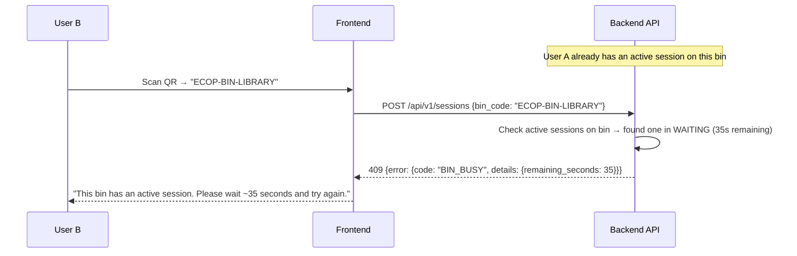
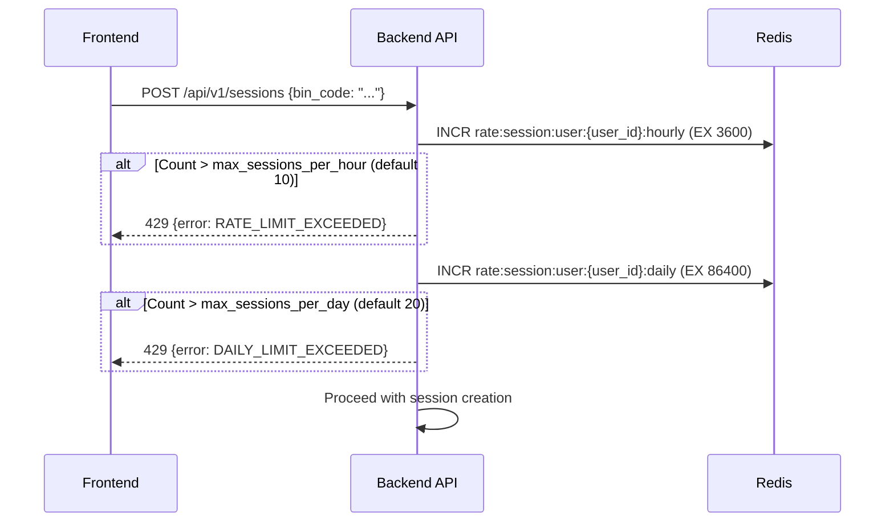
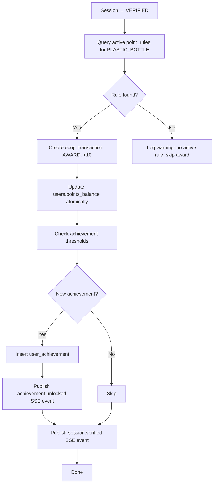

# 12 — Disposal Session Flow

> **Spec file:** `12-disposal-session-flow.md`  
> **Enums referenced:** `SessionStatus`, `VerificationResult`, `BinStatus`, `ErrorCode`, `AchievementKey`, `TransactionType` — defined in [00-index.md](file:///Users/prathambhat/Desktop/EcoP/docs/spec/00-index.md)  
> **API endpoints:** See [10-api-design.md](file:///Users/prathambhat/Desktop/EcoP/docs/spec/10-api-design.md) §4–5  
> **Database tables:** `disposal_sessions`, `waste_events` — see [09-database-schema.md](file:///Users/prathambhat/Desktop/EcoP/docs/spec/09-database-schema.md)

---

## 1. Session State Machine

### Transition Details

| From | To | Trigger | Actor | Side Effects |
|------|----|---------|-------|-------------|
| `[*]` | `WAITING` | User scans QR code, `POST /sessions` | User | Create session row; start 60s countdown; SSE: `session.status_changed` |
| `WAITING` | `PROCESSING` | Waste event received from Awareness Engine | Engine (webhook) | Update session status; SSE: `session.status_changed` |
| `WAITING` | `EXPIRED` | 60s countdown elapses with no engine event | Expiry sweep job (runs every 30s) | Set `end_time`, update status; SSE: `session.status_changed` |
| `PROCESSING` | `VERIFIED` | Engine reports confidence ≥ 0.85 | Engine (webhook) | Award points, create transaction, check achievements; SSE: `session.verified` + `achievement.unlocked` (if applicable) |
| `PROCESSING` | `FAILED` | Engine reports confidence < 0.50 | Engine (webhook) | Set `end_time`; SSE: `session.status_changed` |
| `PROCESSING` | `MANUAL_REVIEW` | Engine reports confidence ≥ 0.50 and < 0.85 | Engine (webhook) | Add to admin review queue; SSE: `session.status_changed` |
| `PROCESSING` | `EXPIRED` | 90s grace window from `start_time` elapses, no conclusive engine response | Expiry sweep job | Set `end_time`; SSE: `session.status_changed` |
| `MANUAL_REVIEW` | `VERIFIED` | Admin clicks "Approve" in review queue | Admin | Award points, create transaction, check achievements; SSE: `session.verified` |
| `MANUAL_REVIEW` | `FAILED` | Admin clicks "Reject" in review queue | Admin | Set `end_time`; SSE: `session.status_changed` |

### Terminal States

`VERIFIED`, `FAILED`, and `EXPIRED` are terminal — no further transitions are possible. `MANUAL_REVIEW` is a holding state that eventually transitions to `VERIFIED` or `FAILED`.

---

## 2. End-to-End Disposal Flow (Happy Path)

---

## 3. Failure Path: Session Expired (No Disposal)

---

## 4. Failure Path: Low Confidence (FAILED)

---

## 5. Borderline Path: Manual Review

---

## 6. Error Path: Bin Busy

---

## 7. Rate Limit Enforcement

---

## 8. Points Award Flow (Detail)

This sub-flow runs when a session transitions to `VERIFIED` (either directly from engine response or from admin approval):

### Atomicity

The following operations execute within a **single database transaction**:
1. Insert `waste_events` row.
2. Update `disposal_sessions.status` to `VERIFIED`.
3. Insert `ecop_transactions` row (type=`AWARD`).
4. Update `users.points_balance`.
5. Insert `user_achievements` row(s) if applicable.

If any step fails, the entire transaction rolls back. SSE events are published **after** the transaction commits successfully.

---

## 9. Timing Summary

| Event | Time | Source |
|-------|------|--------|
| Session created | T+0s | User scans QR |
| User-facing countdown expires | T+60s | Frontend timer |
| Typical engine response | T+5s to T+30s | Awareness Engine processing time |
| Grace window expiry (forced) | T+90s | Expiry sweep job |
| Expiry sweep job interval | Every 30s | APScheduler cron |

### Why 90s Grace Window?

The 60s countdown is the **user-facing timer** — it tells the user how long they have to dispose their bottle. The 90s grace window is the **system timer** — it gives the Awareness Engine up to 30 additional seconds to process and respond after the user's countdown ends. This accounts for:
- Network latency between engine and backend.
- Engine processing time (CV inference can take 2–10 seconds).
- Retry attempts if the first webhook delivery fails.

If no engine response arrives by T+90s, the session is expired by the sweep job, and the user sees "Session expired."
