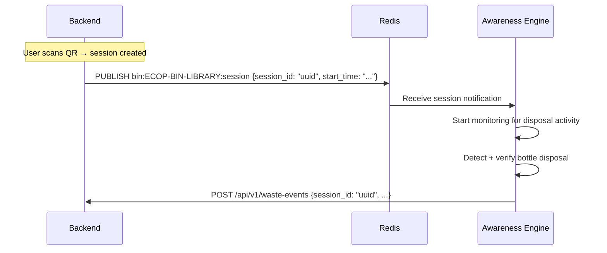

# 13 — Awareness Engine Integration Contract

> **Spec file:** `13-awareness-engine-integration.md`  
> **Enums referenced:** `SessionStatus`, `VerificationResult`, `CameraStatus`, `ErrorCode` — defined in [00-index.md](file:///Users/prathambhat/Desktop/EcoP/docs/spec/00-index.md)  
> **API endpoint:** `POST /api/v1/waste-events` — see [10-api-design.md](file:///Users/prathambhat/Desktop/EcoP/docs/spec/10-api-design.md) §5

---

## 1. Privacy Constraint (Hard Requirement)

> **Non-negotiable. Restated from the PRD for standalone readability.**

The EcoP Awareness Engine:

1. **NEVER performs face recognition** or any form of person identification.
2. **NEVER stores images or video** containing identifiable people beyond the minimum transient buffer needed to run bottle detection (frames are discarded after inference).
3. **NEVER transmits imagery to the backend** — only the structured Waste Event JSON payload defined in §3 below.
4. **NEVER receives or infers the identity** of the user performing the disposal. The Engine has no access to user IDs, session ownership, or any PII.
5. The link between a disposal event and a user is established **exclusively through the Disposal Session** the user created by scanning a QR code on the EcoP Platform.

---

## 2. Engine Responsibilities

The Awareness Engine performs **only** the following functions:

| Function | Description |
|----------|-------------|
| **Bottle Detection** | Identify plastic bottles in the camera feed using a trained computer vision model |
| **Bottle Tracking** | Track detected bottles across frames to follow disposal motion |
| **Disposal Behavior Analysis** | Determine whether a tracked bottle was dropped into the bin (vs. placed nearby, held, etc.) |
| **Disposal Verification** | Produce a confidence score (0.0–1.0) and a `VerificationResult` based on configurable thresholds |

The Engine does **not** perform:
- Person detection, tracking, or identification
- Gender, age, or demographic inference
- Behavior analysis of people (only of bottles)
- Any communication with the EcoP Platform frontend
- Any storage of user data

---

## 3. Waste Event Payload

The Engine sends this JSON payload to the backend via HTTPS webhook.

### Request

**Endpoint:** `POST /api/v1/waste-events`

**Headers:**

| Header | Value | Description |
|--------|-------|-------------|
| `Content-Type` | `application/json` | |
| `X-EcoP-Signature` | `sha256=<hex-digest>` | HMAC-SHA256 signature of the raw request body |
| `X-EcoP-Engine-ID` | `engine-01` | Identifier of the Awareness Engine instance |

**Body:**

```json
{
  "session_id": "550e8400-e29b-41d4-a716-446655440000",
  "bin_id": "ECOP-BIN-LIBRARY",
  "timestamp": "2026-07-28T15:30:25Z",
  "confidence": 0.94,
  "verification_result": "VERIFIED"
}
```

| Field | Type | Required | Description |
|-------|------|----------|-------------|
| `session_id` | UUID (string) | Yes | The disposal session ID. The Engine learns this from the bin's session manager (see §6). |
| `bin_id` | String | Yes | The bin code this Engine is monitoring |
| `timestamp` | ISO-8601 UTC | Yes | When the disposal was detected |
| `confidence` | Float (0.000–1.000) | Yes | Model confidence score |
| `verification_result` | String (`VerificationResult` enum) | Yes | `VERIFIED` (≥0.85), `MANUAL_REVIEW` (0.50–0.85), `FAILED` (<0.50) |

### Threshold Configuration

The thresholds used to determine `verification_result` from `confidence`:

| Setting Key | Default | Stored In |
|-------------|---------|-----------|
| `confidence_threshold_verified` | `0.85` | `admin_settings` table |
| `confidence_threshold_manual_review` | `0.50` | `admin_settings` table |

The Engine must retrieve these thresholds from the backend at startup and periodically (e.g., every 5 minutes) so admin changes take effect without restarting the Engine.

**Threshold Endpoint:** `GET /api/v1/admin/settings?keys=confidence_threshold_verified,confidence_threshold_manual_review` (Engine authenticates with its HMAC credentials, or this is pre-configured on the edge device).

---

## 4. HMAC-SHA256 Signature

### Signing Process (Engine Side)

1. Serialize the request body to a JSON byte string (canonical, no extra whitespace).
2. Compute: `HMAC-SHA256(camera_hmac_secret, request_body_bytes)`.
3. Set header: `X-EcoP-Signature: sha256=<hex-encoded-digest>`.

### Verification Process (Backend Side)

1. Read raw request body bytes (before JSON parsing).
2. Look up the HMAC secret for the engine identified by `X-EcoP-Engine-ID`.
3. Compute: `expected = HMAC-SHA256(secret, raw_body_bytes)`.
4. Constant-time compare `expected` against the digest in `X-EcoP-Signature`.
5. If mismatch → `401 INVALID_SIGNATURE`.

### Secret Management

- Each camera/engine instance has its own `hmac_secret` stored in the `cameras` table.
- Secrets are generated during camera registration in the admin console.
- Secrets are never transmitted in API responses after initial creation (write-only).
- The Engine receives its secret during physical deployment (injected as an environment variable on the edge device).

---

## 5. Backend Response Contract

### Success Response (200)

```json
{
  "data": {
    "message": "Event processed",
    "session_status": "VERIFIED"
  },
  "meta": null,
  "error": null
}
```

### Error Responses

| HTTP Status | Error Code | Engine Action |
|------------|------------|---------------|
| `200` | *(none)* | Event accepted. Do not retry. |
| `400` | `VALIDATION_ERROR` | Payload malformed. **Do not retry** (log error locally). |
| `401` | `INVALID_SIGNATURE` | HMAC verification failed. **Do not retry** (log + alert operator). |
| `404` | `SESSION_NOT_FOUND` | Session ID does not exist. **Do not retry.** |
| `409` | `DUPLICATE_EVENT` | Event for this session already processed. **Do not retry** (idempotent success). |
| `410` | `SESSION_EXPIRED` | Session has already expired. **Do not retry.** |
| `500` | `INTERNAL_ERROR` | Server error. **Retry with backoff.** |
| `503` | *(no body)* | Service unavailable. **Retry with backoff.** |

---

## 6. Retry & Dead-Letter Policy

### Retry Policy (Engine Side)

| Parameter | Value |
|-----------|-------|
| Max retries | 3 |
| Backoff strategy | Exponential |
| Backoff intervals | 1s → 4s → 16s |
| Retry on | `500`, `503`, network timeout |
| Do NOT retry on | `200`, `400`, `401`, `404`, `409`, `410` |

### Dead-Letter (Backend Side)

If the backend receives a webhook but fails to process it (e.g., database error):
1. The event is inserted into the `failed_events` table with the raw payload and error message.
2. The backend returns `500` to the Engine (triggering engine-side retry).
3. After 3 engine retries, the event remains in `failed_events` for admin review.

### Dead-Letter (Engine Side)

If the Engine cannot deliver after 3 retries (e.g., backend completely unreachable):
1. Log the failed event locally on the edge device.
2. Continue processing subsequent events (do not block the pipeline).
3. Optionally: periodically retry failed events from local storage (implementation detail, not specified).

---

## 7. Session Awareness

The Engine needs to know the `session_id` for the currently active session on its bin. There are two approaches:

### Option A: Backend Push (Recommended for V1)

When a session is created for a bin, the backend publishes the `session_id` to a channel the Engine subscribes to:



### Option B: Engine Polls

The Engine periodically polls `GET /api/v1/bins/ECOP-BIN-LIBRARY/active-session` to check if a session is active. Less efficient but simpler.

**Decision:** Use **Option A** (Redis pub/sub push) for lower latency. The Engine subscribes to `bin:{bin_code}:session` on startup.

---

## 8. Camera Heartbeat

Cameras send periodic heartbeats to the backend for health monitoring.

**Endpoint:** `POST /api/v1/admin/cameras/:camera_id/heartbeat`

**Headers:** Same HMAC signing as waste events.

**Body:**

```json
{
  "status": "ONLINE",
  "error_log": null
}
```

| `status` Value | Description |
|----------------|-------------|
| `ONLINE` | Camera operating normally |
| `DEGRADED` | Camera running but with issues (include `error_log`) |

**Frequency:** Every 2 minutes.

**Backend Processing:**
- Update `cameras.status` and `cameras.last_heartbeat`.
- If `error_log` is provided, store it for admin review.
- Cameras that miss heartbeats are marked by a background job:
  - No heartbeat for >5 min → `ONLINE` → stays `ONLINE` (within tolerance)
  - No heartbeat for >10 min → any status → `OFFLINE`

---

## 9. Awareness Engine Deployment (Reference)

| Aspect | Detail |
|--------|--------|
| **Hardware** | Edge compute device (e.g., NVIDIA Jetson Nano/Orin, Raspberry Pi with accelerator) + IP camera |
| **Connectivity** | WiFi or Ethernet to campus network; needs HTTPS access to backend API + Redis |
| **Software** | Python-based CV pipeline (e.g., YOLOv8/v9 for bottle detection) |
| **Model** | Trained on plastic bottle dataset; fine-tuned for bin-specific angles |
| **Processing** | Real-time inference on camera frames; typical latency: 50–200ms per frame |
| **Storage** | No persistent image/video storage; frames discarded after inference |
| **Configuration** | Environment variables: `BACKEND_URL`, `ENGINE_ID`, `HMAC_SECRET`, `BIN_CODE`, `REDIS_URL` |

---

## 10. Integration Test Checklist

For the implementing agent, these are the critical integration scenarios to verify:

| # | Scenario | Expected Outcome |
|---|----------|-----------------|
| 1 | Valid event, confidence 0.94 | Session → VERIFIED, points awarded, 200 response |
| 2 | Valid event, confidence 0.72 | Session → MANUAL_REVIEW, no points yet, 200 response |
| 3 | Valid event, confidence 0.32 | Session → FAILED, no points, 200 response |
| 4 | Duplicate event (same session_id) | 409 DUPLICATE_EVENT, no double-award |
| 5 | Invalid HMAC signature | 401 INVALID_SIGNATURE |
| 6 | Unknown session_id | 404 SESSION_NOT_FOUND |
| 7 | Expired session | 410 SESSION_EXPIRED |
| 8 | Malformed payload (missing field) | 400 VALIDATION_ERROR |
| 9 | Backend DB error during processing | 500 (Engine retries), event in failed_events |
| 10 | Admin approves MANUAL_REVIEW | Session → VERIFIED, points awarded |
| 11 | Admin rejects MANUAL_REVIEW | Session → FAILED, no points |
