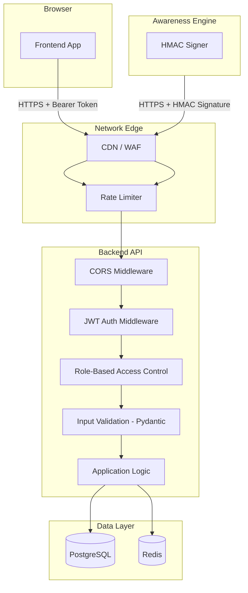

# 17 — Security Design

> **Spec file:** `17-security.md`  
> **Enums referenced:** `UserRole`, `ErrorCode`, `AuthProvider` — defined in [00-index.md](file:///Users/prathambhat/Desktop/EcoP/docs/spec/00-index.md)  
> **Auth flow:** See [11-auth-flow.md](file:///Users/prathambhat/Desktop/EcoP/docs/spec/11-auth-flow.md)  
> **Engine contract:** See [13-awareness-engine-integration.md](file:///Users/prathambhat/Desktop/EcoP/docs/spec/13-awareness-engine-integration.md)

---

## 1. Security Architecture Overview

---

## 2. Authentication Security

### 2.1 Password Hashing

| Parameter | Value |
|-----------|-------|
| Algorithm | Argon2id (via `passlib`) |
| Memory cost | 65536 KB (64 MB) |
| Time cost | 3 iterations |
| Parallelism | 4 |
| Salt | Auto-generated, unique per hash |
| Fallback | bcrypt (for legacy compatibility if migrating from another system) |

### 2.2 JWT Tokens

| Parameter | Access Token | Refresh Token |
|-----------|-------------|---------------|
| Algorithm | HS256 | HS256 |
| Signing key | `SECRET_KEY` env var | `SECRET_KEY` env var |
| Expiry | 15 minutes | 7 days |
| Storage (client) | In-memory (Zustand store) | httpOnly cookie |
| Revocation | Not revocable (short-lived) | Redis blacklist on `jti` |
| Contains PII | Minimal (`sub`, `email`, `role`) | Minimal (`sub`, `jti`) |

### 2.3 Refresh Token Cookie Security

| Attribute | Value | Purpose |
|-----------|-------|---------|
| `httpOnly` | `true` | Not accessible via JavaScript (XSS protection) |
| `Secure` | `true` | Only sent over HTTPS |
| `SameSite` | `Strict` | Not sent on cross-site requests (CSRF protection) |
| `Path` | `/api/v1/auth` | Only sent to auth endpoints (minimizes exposure) |
| `Max-Age` | `604800` | 7 days |

### 2.4 CSRF Protection

- **Primary defense:** `SameSite=Strict` cookie attribute prevents cross-site request forgery for the refresh token.
- **Additional defense:** The access token is in memory (not a cookie), so it's immune to CSRF.
- **No CSRF token needed:** Since the access token (Bearer header) is not a cookie, and the refresh token cookie is `SameSite=Strict`, CSRF attacks cannot succeed.

### 2.5 Brute-Force Protection

| Target | Rate Limit | Key | Window |
|--------|-----------|-----|--------|
| Login endpoint | 10 attempts | Per IP address | 1 minute |
| Registration endpoint | 5 attempts | Per IP address | 5 minutes |
| Password reset endpoint | 3 attempts | Per email | 15 minutes |
| Email verification | 5 attempts | Per token prefix | 5 minutes |

Implementation: Redis-backed sliding window counter.

---

## 3. Role-Based Access Control (RBAC)

### 3.1 Access Matrix

| Resource | `STUDENT` | `FACULTY` | `EXTERNAL_VISITOR` | `ADMIN` |
|----------|:---------:|:---------:|:-------------------:|:-------:|
| Register/Login | ✅ | ✅ | ✅ | ✅ |
| Own profile CRUD | ✅ | ✅ | ✅ | ✅ |
| Create disposal session | ✅ | ✅ | ✅ | ✅ |
| View own sessions/history | ✅ | ✅ | ✅ | ✅ |
| View leaderboards | ✅ | ✅ | ✅ | ✅ |
| View/redeem rewards | ✅ | ✅ | ✅ | ✅ |
| View achievements | ✅ | ✅ | ✅ | ✅ |
| Admin console | ❌ | ❌ | ❌ | ✅ |
| Manage users | ❌ | ❌ | ❌ | ✅ |
| Manage bins/cameras | ❌ | ❌ | ❌ | ✅ |
| Manage rewards/points | ❌ | ❌ | ❌ | ✅ |
| Review disposals | ❌ | ❌ | ❌ | ✅ |
| View analytics | ❌ | ❌ | ❌ | ✅ |
| Edit system settings | ❌ | ❌ | ❌ | ✅ |
| Grant/revoke admin | ❌ | ❌ | ❌ | ✅ |

### 3.2 Implementation

- FastAPI dependency: `require_role(*roles: UserRole)` — returns a dependency that validates the current user's role.
- Raises `403 FORBIDDEN` with `ErrorCode.FORBIDDEN` if role check fails.
- Applied at the router level for all admin endpoints.

---

## 4. Input Validation

### 4.1 Backend (Pydantic v2)

All request bodies are validated by Pydantic models before reaching service logic:

| Validation | Approach |
|-----------|----------|
| Required fields | Pydantic model field definitions |
| String length limits | `Field(min_length=2, max_length=100)` |
| Email format | Pydantic `EmailStr` type |
| UUID format | Pydantic `UUID4` type |
| Enum values | Pydantic `Literal` or enum constraints |
| Numeric ranges | `Field(ge=0, le=1)` for confidence, `Field(gt=0)` for points |
| Custom validation | `@field_validator` for password complexity, bin code format |
| SQL injection | Parameterized queries via SQLAlchemy ORM (never raw string interpolation) |

### 4.2 Frontend (Zod)

All form inputs validated by Zod schemas before API submission:

| Validation | Approach |
|-----------|----------|
| Required fields | Zod `.min(1)` or type enforcement |
| Email format | `z.string().email()` |
| Password complexity | Custom Zod refinement matching backend rules |
| Confirm password | Zod `.refine()` matching password field |
| SAP ID | `z.string().min(1).max(50)` |
| Bin code | `z.string().regex(/^ECOP-BIN-.+$/)` |

### 4.3 Output Sanitization

- All user-generated content (names, descriptions) is rendered via React (which auto-escapes HTML).
- No `dangerouslySetInnerHTML` usage anywhere in the codebase.
- API responses never include raw SQL, stack traces, or internal error details in production.

---

## 5. Webhook Security (Awareness Engine)

### 5.1 HMAC-SHA256 Authentication

| Parameter | Value |
|-----------|-------|
| Algorithm | HMAC-SHA256 |
| Secret storage | `cameras.hmac_secret` (per-camera), never in code |
| Header | `X-EcoP-Signature: sha256=<hex-digest>` |
| Engine identification | `X-EcoP-Engine-ID` header |
| Verification | Constant-time comparison (`hmac.compare_digest()`) |

### 5.2 Webhook Hardening

| Protection | Implementation |
|-----------|---------------|
| Replay prevention | `timestamp` in payload must be within ±5 minutes of server time |
| Idempotency | UNIQUE constraint on `waste_events.session_id` prevents double-processing |
| Body size limit | Max 1KB payload (reject larger bodies before parsing) |
| Rate limiting | 100 requests/minute per engine ID |
| IP allowlisting | (Optional, V2) Restrict webhook endpoint to known edge device IPs |

---

## 6. Rate Limiting

### 6.1 Strategy

**Implementation:** Redis-backed token bucket (or sliding window counter).

### 6.2 Rate Limit Rules

| Endpoint/Action | Limit | Window | Key | Response |
|----------------|-------|--------|-----|----------|
| API-wide (per IP) | 100 requests | 1 minute | IP | 429 |
| `POST /auth/login` | 10 attempts | 1 minute | IP | 429 |
| `POST /auth/register` | 5 attempts | 5 minutes | IP | 429 |
| `POST /auth/forgot-password` | 3 attempts | 15 minutes | Email | 429 |
| `POST /sessions` (hourly) | configurable (default 10) | 1 hour | User ID | 429 `RATE_LIMIT_EXCEEDED` |
| `POST /sessions` (daily) | configurable (default 20) | 24 hours | User ID | 429 `DAILY_LIMIT_EXCEEDED` |
| `POST /waste-events` | 100 requests | 1 minute | Engine ID | 429 |

### 6.3 Response Headers

On rate-limited responses, include:

| Header | Value |
|--------|-------|
| `Retry-After` | Seconds until the rate limit resets |
| `X-RateLimit-Limit` | Maximum requests allowed in window |
| `X-RateLimit-Remaining` | Remaining requests in current window |
| `X-RateLimit-Reset` | Unix timestamp when the window resets |

---

## 7. CORS Policy

### Configuration

| Parameter | Development | Production |
|-----------|------------|------------|
| Allowed origins | `http://localhost:3000` | `https://ecop.dev` |
| Allowed methods | `GET, POST, PATCH, DELETE, OPTIONS` | Same |
| Allowed headers | `Authorization, Content-Type, X-EcoP-Signature, X-EcoP-Engine-ID` | Same |
| Expose headers | `X-RateLimit-Limit, X-RateLimit-Remaining, X-RateLimit-Reset, Retry-After` | Same |
| Credentials | `true` (for cookies) | `true` |
| Max age | `3600` (1 hour preflight cache) | Same |

**Critical:** Never use `*` for allowed origins. Always use an explicit allowlist configured via environment variable.

---

## 8. Data Protection

### 8.1 PII Handling

| Data | Classification | Storage | Logging | Transmission |
|------|---------------|---------|---------|-------------- |
| Email | PII | Encrypted at rest (DB-level) | Masked in logs (`a***@example.com`) | HTTPS only |
| Password | Credential | Argon2id hash only | Never logged | HTTPS only |
| Full Name | PII | Encrypted at rest | Masked in logs | HTTPS only |
| SAP ID | PII | Encrypted at rest | Never logged | HTTPS only |
| Session IDs | Internal | Plaintext | Allowed in logs | HTTPS only |
| Bin codes | Public | Plaintext | Allowed in logs | HTTPS only |
| Points balance | User data | Plaintext | Allowed in logs | HTTPS only |

### 8.2 Privacy-by-Design

- **No facial recognition** — hard constraint, never implemented.
- **No image storage** — Awareness Engine discards frames after inference.
- **No image transmission** — only structured JSON payloads sent to backend.
- **No PII in Awareness Engine** — Engine never knows user identity.
- **Session-based linkage only** — disposal events linked to users only through QR-initiated sessions.
- **Minimal data collection** — only data necessary for the service is collected.

### 8.3 Secrets Management

| Secret | Storage | Never In |
|--------|---------|----------|
| Database credentials | Environment variables / secret manager | Source code, git, logs |
| JWT signing key | Environment variables / secret manager | Source code, git, logs |
| HMAC secrets | `cameras` table (write-only field) | API responses (after creation), logs |
| SMTP credentials | Environment variables / secret manager | Source code, git, logs |

**Rules:**
- `.env` files are in `.gitignore`.
- `.env.example` contains placeholder values only.
- Production secrets stored in a secret manager (AWS Secrets Manager, GCP Secret Manager, or HashiCorp Vault).
- Secrets are never logged, never included in error messages, never returned in API responses.

---

## 9. Security Headers

The backend and/or reverse proxy should set:

| Header | Value | Purpose |
|--------|-------|---------|
| `Strict-Transport-Security` | `max-age=63072000; includeSubDomains; preload` | Force HTTPS |
| `X-Content-Type-Options` | `nosniff` | Prevent MIME sniffing |
| `X-Frame-Options` | `DENY` | Prevent clickjacking |
| `X-XSS-Protection` | `0` | Disable legacy XSS filter (modern CSP is better) |
| `Referrer-Policy` | `strict-origin-when-cross-origin` | Limit referrer leakage |
| `Content-Security-Policy` | `default-src 'self'; script-src 'self'; style-src 'self' 'unsafe-inline' fonts.googleapis.com; font-src fonts.gstatic.com; img-src 'self' data: https:; connect-src 'self' {API_URL}` | XSS mitigation |
| `Permissions-Policy` | `camera=(self), microphone=(), geolocation=()` | Restrict browser APIs |

---

## 10. Audit Trail

### What's Logged

| Action | Table | Fields Captured |
|--------|-------|----------------|
| Admin modifies user | `admin_audit_log` | actor_id, action='update_user', entity_type='user', entity_id, before/after state |
| Admin approves/rejects review | `admin_audit_log` | actor_id, action='approve_review' or 'reject_review', session details |
| Admin modifies settings | `admin_audit_log` | actor_id, action='update_setting', key, old value, new value |
| Admin modifies rewards | `admin_audit_log` | actor_id, action='update_reward', reward details |
| Admin modifies bins | `admin_audit_log` | actor_id, action='update_bin', bin details |
| Points awarded | `ecop_transactions` | user_id, type, amount, reference_id |
| Points deducted (redemption) | `ecop_transactions` | user_id, type, amount, reference_id |

Both `admin_audit_log` and `ecop_transactions` are **append-only** — no UPDATE or DELETE operations.

---

## 11. Security Checklist

For the implementing agent, verify these before considering security complete:

- [ ] Passwords hashed with Argon2id, never stored in plaintext
- [ ] JWT access tokens expire in 15 minutes
- [ ] Refresh tokens in httpOnly + Secure + SameSite=Strict cookies
- [ ] Refresh token rotation with Redis blacklisting
- [ ] CORS configured with explicit origin allowlist (no `*`)
- [ ] All inputs validated with Pydantic (backend) and Zod (frontend)
- [ ] SQL injection prevented via SQLAlchemy ORM (no raw SQL string interpolation)
- [ ] XSS prevented via React auto-escaping (no `dangerouslySetInnerHTML`)
- [ ] HMAC-SHA256 webhook verification with constant-time comparison
- [ ] Rate limiting on auth endpoints and session creation
- [ ] No PII in logs (emails masked, passwords never logged, SAP IDs never logged)
- [ ] No secrets in source code or git history
- [ ] Security headers configured (HSTS, CSP, X-Frame-Options, etc.)
- [ ] Admin endpoints require `ADMIN` role
- [ ] Audit log captures all admin write operations
- [ ] Error responses never expose internal details (stack traces, SQL queries)
- [ ] No facial recognition or user-identifying imagery anywhere in the system
